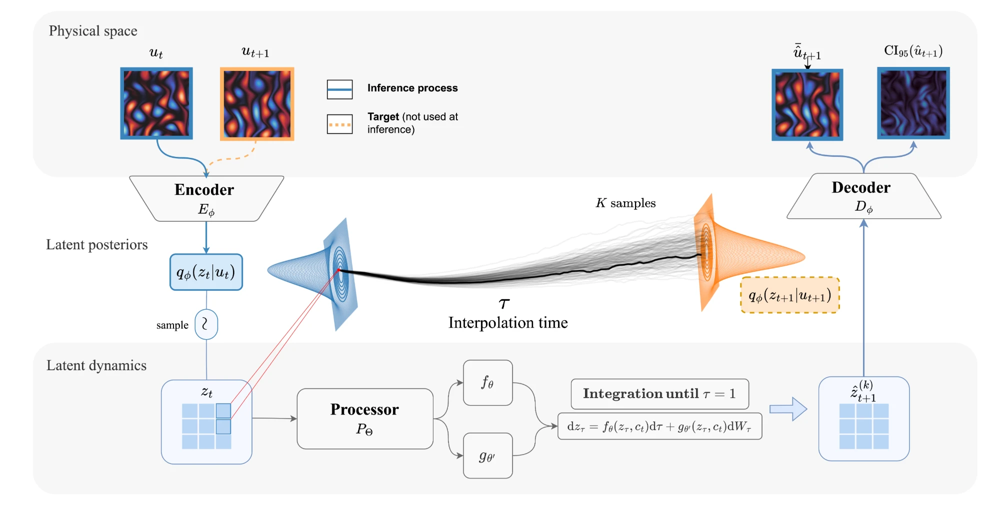
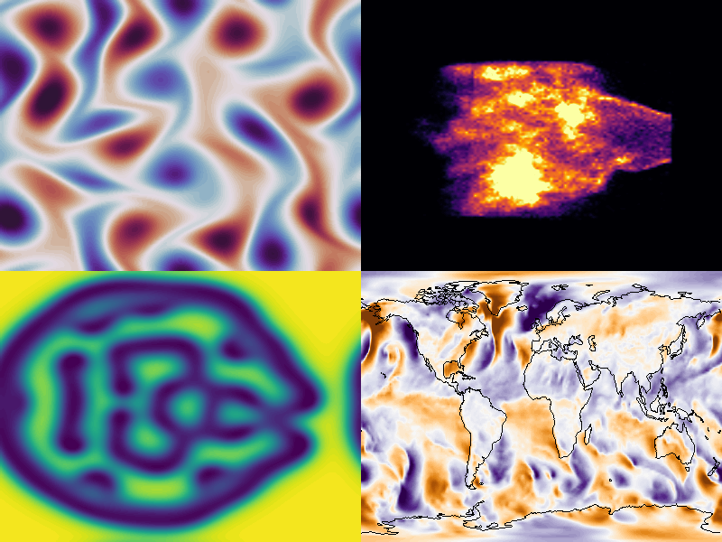

<h2 align="center">🌪️ TORNADO: Adaptive Latent Stochastic Transport for Calibrated Probabilistic PDE Forecasting</h2>

<p align="center">
  Jorge Mifsut Benet<sup>1</sup> · Armand Kassaï Koupaï<sup>1</sup> · Ramon Daniel Regueiro-Espino<sup>1</sup> · Nicolas Baskiotis<sup>1</sup> · Patrick Gallinari<sup>1,2</sup>
</p>

<p align="center">
  <sup>1</sup>Sorbonne Université, CNRS, ISIR, Paris · <sup>2</sup>Criteo AI Lab, Paris
</p>

<p align="center">
  NeurIPS 2026
</p>

<hr>

<p align="center">
  <a href="PAPER_URL"><strong>Paper</strong></a> ·
  <a href="src"><strong>Code</strong></a> ·
  <a href="https://huggingface.co/datasets/jorge-mif/apebench"><strong>Data</strong></a>
</p>

<p align="center">
  
  
</p>

<hr>

## Setup

```bash
git clone https://github.com/jorge-mifsut/tornado.git
cd tornado/src
pip install -r requirements.txt
```

Training, data and evaluation are documented in [`src/`](src).

## Cite

```bibtex
@inproceedings{mifsutbenet2026tornado,
  title     = {TORNADO: Adaptive Latent Stochastic Transport for Calibrated Probabilistic PDE Forecasting},
  author    = {Mifsut Benet, Jorge and Kassa{\"i} Koupa{\"i}, Armand and Regueiro-Espino, Ramon Daniel and Baskiotis, Nicolas and Gallinari, Patrick},
  booktitle = {Advances in Neural Information Processing Systems},
  year      = {2026},
}
```
